# tacacs-ng-ui User Guide


---

> ### ⚠️ IMPORTANT — READ FIRST
>
> **Whenever you change any TACACS configuration (users, groups, hosts, profiles, rulesets, settings), you MUST go to TACACS Configs → Generate Config → mark the new config as Active.**
>
> Changes do NOT take effect on the TACACS+ server until the config is regenerated and activated.

---

## Table of Contents

1. [Getting Started](#getting-started)
2. [Initial Data (Seed)](#initial-data-seed)
3. [Core Concepts](#core-concepts)
4. [Step-by-Step: First-Time Setup](#step-by-step-first-time-setup)
4. [Managing TACACS+ Users & Groups](#managing-tacacs-users--groups)
5. [Configuring Network Devices (Hosts)](#configuring-network-devices-hosts)
6. [Access Control: Profiles & Rulesets](#access-control-profiles--rulesets)
7. [Server Settings](#server-settings)
8. [Generating and Applying Config Files](#generating-and-applying-config-files)
9. [Dashboard Overview](#dashboard-overview)
10. [TACACS Log Events Viewer](#tacacs-log-events-viewer)
11. [SIEM Integration](#siem-integration)
12. [Monitoring & Statistics](#monitoring--statistics)
13. [Audit Logs](#audit-logs)
14. [Application User Management](#application-user-management)
15. [Advanced: MAVIS Backends](#advanced-mavis-backends)
16. [Advanced: Custom Configuration Options](#advanced-custom-configuration-options)
17. [Troubleshooting](#troubleshooting)

---

## Getting Started

### Login

Navigate to your dashboard URL (e.g., `http://localhost:5173` or your configured domain).

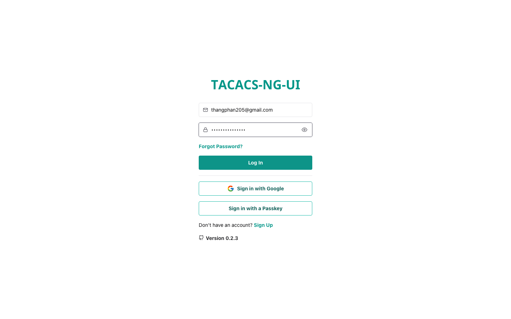

Login options:
- **Email + Password** — default method
- **Sign in with Google** — requires Google OAuth configured in `.env`
- **Sign in with Keycloak** — requires Keycloak OIDC configured
- **Sign in with Microsoft** — personal Microsoft accounts and Entra ID; requires the Microsoft provider configured
- **Passkeys** — passwordless login via WebAuthn (biometrics/hardware key)

Default admin credentials are set via `FIRST_SUPERUSER` and `FIRST_SUPERUSER_PASSWORD` in your `.env` file.

After login you land on the main dashboard:

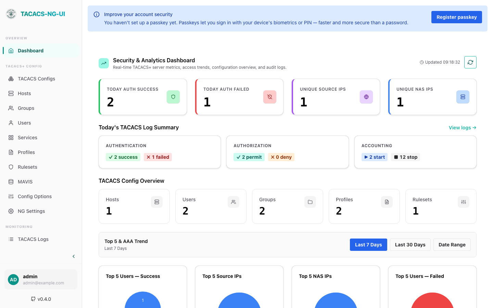

---

## Initial Data (Seed)

On first startup, tacacs-ng-ui automatically creates the following data. This gives you a working TACACS+ configuration out of the box for Cisco, Arista, Huawei, Juniper, Palo Alto, and Fortinet devices.

The seed runs **once**, against an empty database. Restarts and upgrades never re-create or reset it, so deleting, renaming, or editing any of these entries is permanent. Everything except the services is demo data, created only when `SEED_DEMO_DATA=true` (the default in `.env.example`; `setup.sh` and the production deploy workflow set `false`). The demo host `DEMO_HOSTS` accepts any client (`0.0.0.0/0`) with the shared key `change_this`.

### Services

| Name | Used by |
|------|---------|
| `shell` | Cisco, Arista, Huawei VRP |
| `junos-exec` | Juniper |
| `h3c_shell` | Huawei H3C / Comware |
| `PaloAlto` | Palo Alto Networks |
| `fortigate` | Fortinet FortiGate |

### Groups

| Group | Purpose |
|-------|---------|
| `tacacs_super_user` | Full admin access — privilege level 15 |
| `tacacs_read_only` | Read-only access — privilege level 1 |

### TACACS+ Users

| Username | Password | Group | Purpose |
|----------|----------|-------|---------|
| `user_admin` | `change_this` | `tacacs_super_user` | Admin — full access on all devices |
| `user_read_only` | `change_this` | `tacacs_read_only` | Read-only on all devices |

> **Action required:** Change these passwords — and the `DEMO_HOSTS` key — via **TACACS Users → Edit** and **Hosts → Edit**, or delete the entries, then Generate + Activate. Until you do, the TACACS Users, Hosts and TACACS Configs pages show a red **Default demo credentials in use** warning naming every user or host still on `change_this`.

### Profiles & Authorization Attributes

**`tacacs_super_user_profile`** — returned for `tacacs_super_user` group members:

| Service | Attribute returned | Value |
|---------|--------------------|-------|
| `shell` | `priv-lvl` | `15` |
| `junos-exec` | `local-user-name` | `tacacs_super_user` |
| `h3c_shell` | `priv-lvl` | `15` |
| `PaloAlto` | `PaloAlto-Admin-Role` | `superuser` |
| `fortigate` | `admin_prof` | `super_admin` |

**`tacacs_read_only_profile`** — returned for `tacacs_read_only` group members:

| Service | Attribute returned | Value |
|---------|--------------------|-------|
| `shell` | `priv-lvl` | `1` |
| `junos-exec` | `local-user-name` | `tacacs_read_only` |
| `h3c_shell` | `priv-lvl` | `1` |
| `PaloAlto` | `PaloAlto-Admin-Role` | `devicereader` |
| `fortigate` | `admin_prof` | `read_only` |

### Ruleset

`default_ruleset` maps each group to its profile:

| If group is | → Apply profile |
|-------------|-----------------|
| `tacacs_super_user` | `tacacs_super_user_profile` |
| `tacacs_read_only` | `tacacs_read_only_profile` |
| *(no match)* | deny |

### Authorization Flow

```
Network device → user_admin authenticates
  ↓
tac_plus-ng: member = tacacs_super_user
  ↓
default_ruleset: group == tacacs_super_user → tacacs_super_user_profile
  ↓
service == shell → return priv-lvl=15
  ↓
Device grants full admin access
```

### Next Steps After First Login

1. Change `user_admin` and `user_read_only` passwords (**TACACS Users → Edit**)
2. Add your network devices (**Hosts → Add Host**)
3. Generate and activate the config (**TACACS Configs → Generate → Activate**)
4. Configure your devices to point at this TACACS+ server

---

## Core Concepts

Understanding how tacacs-ng-ui maps to a TACACS+ config:

| Concept | What it does |
|---------|-------------|
| **TACACS User** | A network device user (the person logging into a router/switch) |
| **TACACS Group** | A group that users belong to; policies are applied to the group |
| **Host** | A network device (router, switch, firewall) that authenticates against the TACACS+ server |
| **Profile** | Defines what attributes (service, privilege level) are returned in an authorization response |
| **Ruleset** | Conditional access rules — permits or denies based on user/group/service/command |
| **TACACS Config** | The generated configuration file loaded by the `tac_plus-ng` daemon |
| **MAVIS** | An external authentication backend (e.g., LDAP/AD) used instead of local passwords |

> **Reminder:** After modifying any of the above, always regenerate and activate the config. See [Generating and Applying Config Files](#generating-and-applying-config-files).

---

## Step-by-Step: First-Time Setup

Follow this order when configuring from scratch:

### 1. Configure Server Settings

Go to **TACACS-NG Settings** and set:
- IPv4 address and port (default: `0.0.0.0`, port `49`)
- Log file paths for authentication, authorization, and accounting
- Authentication/user backends (`local`, `mavis`, `pap`, etc.)

### 2. Create TACACS Groups

Go to **TACACS Groups** → **Add Group**.
- Example groups: `network-admins`, `read-only-ops`

### 3. Create TACACS Users

Go to **TACACS Users** → **Add User**.
- Set `username`, `password`, `password_type` (`pap`), and assign to a group.

### 4. Create Profiles (Authorization Attributes)

Go to **Profiles** → **Add Profile**.
- Set `action` to `permit` or `deny`.
- Add **Profile Scripts** to return key-value pairs to devices (e.g., `service=exec`, `priv-lvl=15`).

### 5. Create Rulesets (Access Control)

Go to **Rulesets** → **Add Ruleset**.
- Define conditional rules that match users/groups/services and map them to profiles.
- Add **Ruleset Scripts** with conditions (e.g., `$user == "admin"`, `$nas == "192.168.1.1"`).

### 6. Add Network Devices (Hosts)

Go to **Hosts** → **Add Host**.
- Set the device IP address and `secret_key` (must match what is configured on the device).

### 7. Generate and Activate Config

> **⚠️ This step is required after EVERY configuration change.**

Go to **TACACS Configs** → **Generate Config** → mark the new config as **Active**.

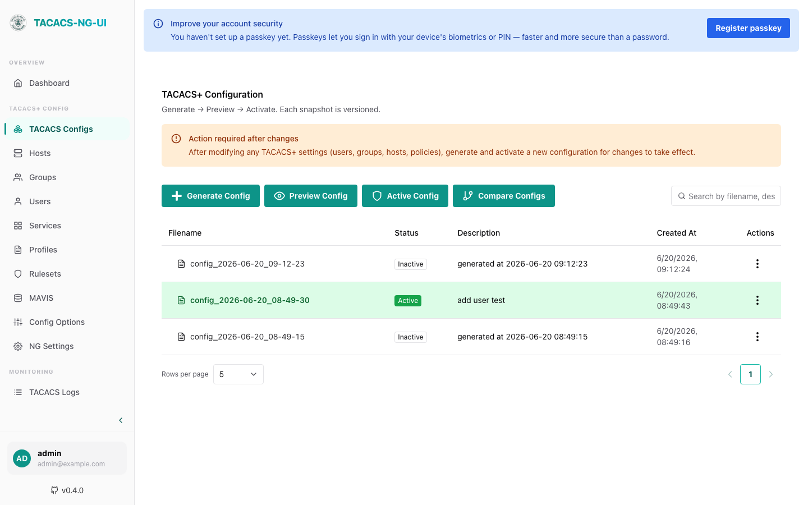

### 8. Configure Network Devices

Point your routers/switches at the TACACS+ server. See [device examples](#typical-device-side-configuration).

---

## Managing TACACS+ Users & Groups

### TACACS Groups

**Path:** Sidebar → TACACS Groups

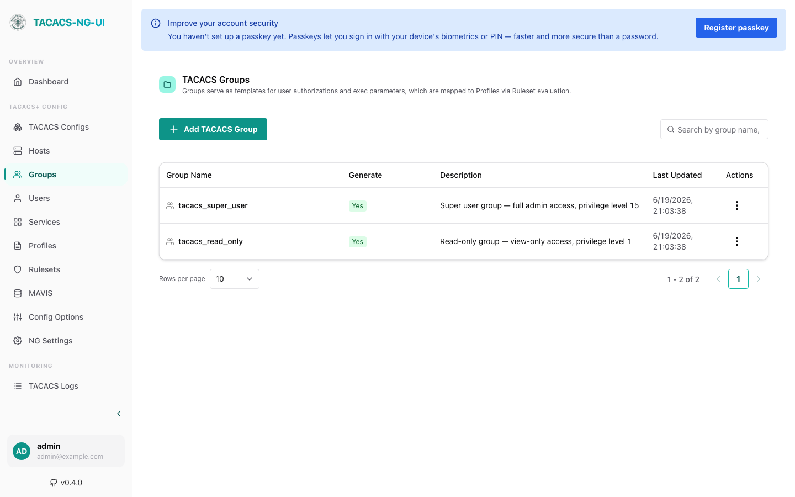

| Field | Description |
|-------|-------------|
| `group_name` | Unique name for the group (e.g., `network-admins`) |
| `description` | Optional description |

Groups are referenced in TACACS Users and Rulesets to apply policies to multiple users at once.

### TACACS Users

**Path:** Sidebar → TACACS Users

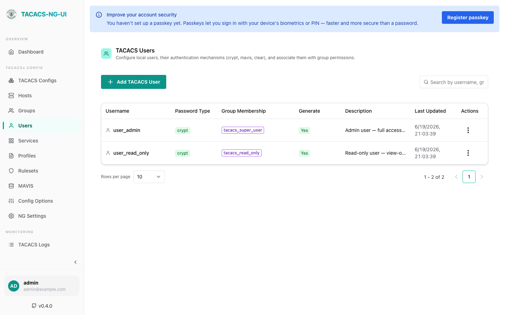

| Field | Description |
|-------|-------------|
| `username` | Login name used on network devices |
| `password` | User's password (stored hashed) |
| `password_type` | Protocol for password exchange — typically `pap` |
| `member` | Group this user belongs to |
| `email` | Optional contact address (informational; not emitted in the config) |
| `account_expires_at` | Optional last valid day. After this date the user is left out of the generated config — it takes effect on the next Generate + Activate (the TACACS Configs page flags it as an unapplied change). The Users list shows the days remaining |
| `description` | Optional description |

**Notes:**
- `password_type: pap` is the most common. Use `login` for ASCII auth.
- Users inherit policies from their group via Rulesets.

> **After adding/editing users:** regenerate and activate config.

---

## Configuring Network Devices (Hosts)

**Path:** Sidebar → Hosts

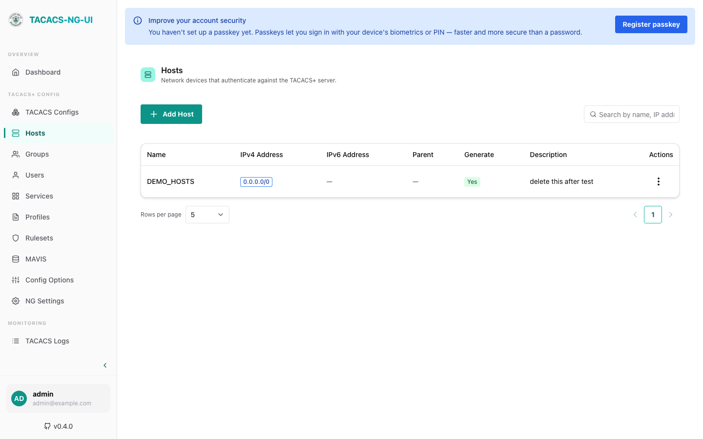

| Field | Description |
|-------|-------------|
| `name` | Identifier for the host (e.g., `core-switch-01`) |
| `ipv4_address` | Device IP address (used to match TACACS requests) |
| `ipv6_address` | Optional IPv6 address |
| `secret_key` | Shared secret — must match the device's TACACS key config. Optional when `parent` is set (the child inherits the parent's key) |
| `parent` | Optional parent host. Emitted as `parent = <host>`; the parent is written first, so one host (e.g. without an address) can act as a shared template for many devices |
| `welcome_banner` | Message sent to the user on successful login |
| `reject_banner` | Message sent on denied access |
| `motd_banner` | Message of the day shown after login |
| `failed_authentication_banner` | Message sent on failed authentication |

> **After adding/editing hosts:** regenerate and activate config.

### Typical Device-Side Configuration

**Cisco IOS / IOS-XE:**
```bash
! 1. Enable AAA first (must be before tacacs server block)
aaa new-model

! 2. Define the TACACS+ server
tacacs server MY-TACACS
  address ipv4 <TACACS_SERVER_IP>
  key <secret_key>
  exit

! 3. Create a named server group (allows easy failover/redundancy)
aaa group server tacacs+ TACACS-GROUP
  server name MY-TACACS
  exit

! 4. Authentication, Authorization, Accounting
aaa authentication login default group TACACS-GROUP local
aaa authorization exec default group TACACS-GROUP local
aaa accounting exec default start-stop group TACACS-GROUP
aaa accounting commands 15 default start-stop group TACACS-GROUP

! 5. Apply to VTY lines (SSH/Telnet) — required or TACACS won't be used
line vty 0 4
  login authentication default
  exit
```

**Juniper JunOS:**
```bash
# 1. Define local user classes that TACACS users will be mapped to
set system login class tacacs-admin permissions all
set system login class tacacs-read permissions [ view view-configuration ]
set system login user user_demo uid 9999 class tacacs-admin

# 2. Configure TACACS+ server (source-address = management interface IP)
set system tacplus-server <TACACS_SERVER_IP> port 49 secret <secret_key>
set system tacplus-server <TACACS_SERVER_IP> source-address <DEVICE_MGMT_IP>

# 3. Set authentication order (TACACS first, local password fallback)
set system authentication-order tacplus
set system authentication-order password

# 4. Enable accounting
set system accounting events login
set system accounting events interactive-commands
set system accounting destination tacplus server <TACACS_SERVER_IP> secret <secret_key>
set system accounting destination tacplus server <TACACS_SERVER_IP> source-address <DEVICE_MGMT_IP>
```

**Arista EOS:**
```bash
# 1. Define TACACS+ server (key 7 = encrypted; key 0 = plaintext, avoid in production)
tacacs-server host <TACACS_SERVER_IP> key 7 <encrypted_secret_key>

# 2. Create a named server group
aaa group server tacacs+ TACACS-GROUP
   server <TACACS_SERVER_IP>
!

# 3. Authentication, Authorization, Accounting
aaa authentication login default group TACACS-GROUP local
aaa authorization exec default group TACACS-GROUP local
aaa authorization commands all default group TACACS-GROUP local
aaa accounting exec default start-stop group TACACS-GROUP

# 4. Source TACACS traffic from management interface
ip tacacs source-interface Management0
```

---

## Access Control: Profiles & Rulesets

### Profiles

**Path:** Sidebar → Profiles

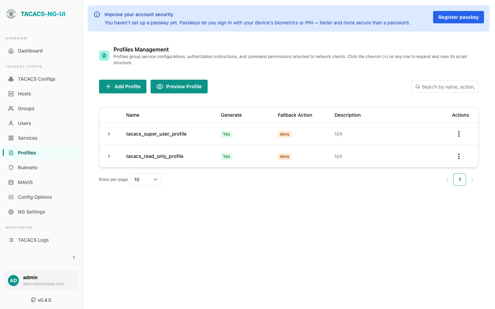

Profiles define the **authorization response** sent back to a device when access is granted.

| Field | Description |
|-------|-------------|
| `name` | Profile identifier |
| `action` | `permit` or `deny` |
| `description` | Optional description |

#### Profile Scripts

Add attribute-value pairs returned to the device in the authorization response.

**Path:** Profiles → select profile → Profile Scripts

| Field | Description |
|-------|-------------|
| `condition` | Optional condition expression (e.g., `$user == "admin"`) |
| `key` | Attribute name (e.g., `priv-lvl`, `service`) |
| `value` | Attribute value (e.g., `15`, `exec`) |
| `action` | `set`, `add`, or `optional` |

**Example — Grant full privilege to admins:**
```
key: service     value: exec
key: priv-lvl    value: 15
```

**Example — Read-only access:**
```
key: service     value: exec
key: priv-lvl    value: 1
```

#### Profile Script Sets

Sub-parameters for a profile script entry (used for service-level attributes like `cmd` authorization).

#### Raw script profiles

Profile Scripts model the basic case: one `if (key == value)` test and `set`
lines. Policies that need more, such as per-command authorization with nested
`if`, `add` (an optional attribute, unlike `set`) or regex matches on `cmd`,
are written as raw `tac_plus-ng` text on the profile itself.

In **Add Profile** / **Edit Profile**, choose **Script mode → Raw script** and
paste the body of `script { }`. The generator writes the wrapper:

```
profile ro_cmd_profile {
    script {
        <your text>
    }
}
```

```
if (service == shell) {
    if (cmd == "") { set priv-lvl = 1  permit }
    if (cmd =~ /^(show|display|ping|traceroute|terminal|exit|quit)(\s|$)/) permit
    deny
}
deny
```

- End the text with your own `permit` or `deny`: the profile's fallback action
  is not emitted for a raw script.
- Don't paste the `profile` or `script` lines, keep braces balanced, and don't
  use `include`; the form refuses these. Put a space before a `#` comment, and
  quote a value that contains `#`.
- The text is written into the config exactly as entered, indentation
  included.
- **Check with tac_plus-ng** runs `tac_plus-ng -P` on the full config with your
  unsaved text and points at the line of the script it rejects.
- A profile is either structured or raw. Delete a profile's Profile Scripts
  before switching it to raw; scripts can't be added to a raw profile.
- A raw profile is an ordinary profile: it appears in the Rulesets `profile`
  dropdown and in the MCP entity tools.

### Rulesets

**Path:** Sidebar → Rulesets

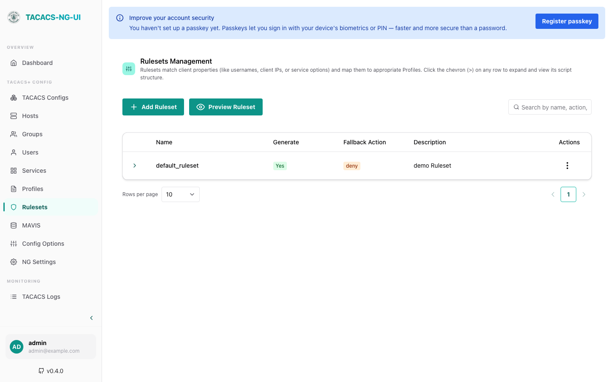

Rulesets define **which users get which profile** based on conditions.

| Field | Description |
|-------|-------------|
| `name` | Ruleset identifier |
| `enabled` | `yes` or `no` — toggle without deleting |
| `action` | Default action if no script matches: `permit` or `deny` |
| `description` | Optional description |

#### Ruleset Scripts

Add conditional rules within a ruleset.

**Path:** Rulesets → select ruleset → Ruleset Scripts

| Field | Description |
|-------|-------------|
| `condition` | `if`, `elif` or `else` (`else` takes no test) |
| `key` | Attribute to test, e.g. `service`, `host`, `member` |
| `value` | Value the attribute is compared with (rendered as `if (key==value)`) |
| `action` | `permit` or `deny` for this script block |

The UI covers a flat `if` / `elif` / `else` chain with a single equality test.
For nested conditions, `&&` / `||`, regex or negation, see
[Complex rules](#complex-rules) below.

**Example ruleset logic:**
```
condition: $group == "network-admins"   action: permit   key: priv-lvl   value: 15
condition: $group == "read-only"        action: permit   key: priv-lvl   value: 1
default action: deny
```

#### Order matters: the first match wins

tac_plus-ng tests the script blocks of a profile or a ruleset from top to
bottom and stops at the first `permit` or `deny` it reaches. The rules inside
the `ruleset { }` block are tried the same way. A broad block placed above a
narrower one therefore hides it:

```
if (service==shell)     { set priv-lvl=1  ; permit }   # matches every shell session first
if (device==CORE-SW-01) { set priv-lvl=15 ; permit }   # never reached
```

Put the specific blocks first and the catch-all last.

- The **Script Structure** view of a profile or ruleset lists the blocks in the
  order the generator writes them, numbered `#1`, `#2`, … Use the **↑ / ↓**
  buttons on a block to move it.
- The **Rulesets** list is shown in rule order. Its ↑ / ↓ buttons appear when no
  search filter is active.
- A new block or ruleset is appended at the end. Editing a block (its value, its
  sets, its description) never changes its place.
- An `elif` or `else` continues the `if` directly above it. A move that would
  leave one without that `if` is refused.
- A block with no **Script Sets** is still emitted, for example
  `if (device==LAB-SW) { deny }`.

The `check` step validates syntax only. It cannot tell that a block is in the
wrong place, so review the **Preview** before you activate.

Over the API, every script and ruleset has a 0-based `position`. Pass it on
create to insert at that place (leave it out to append), or call
`POST /api/v1/profilescripts/{id}/move`, `/rulesetscripts/{id}/move` or
`/rulesets/{id}/move` with `{"position": n}`. The siblings are renumbered in the
same transaction.

> **After adding/editing profiles or rulesets:** regenerate and activate config.

---

## Server Settings

**Path:** Sidebar → TACACS-NG Settings

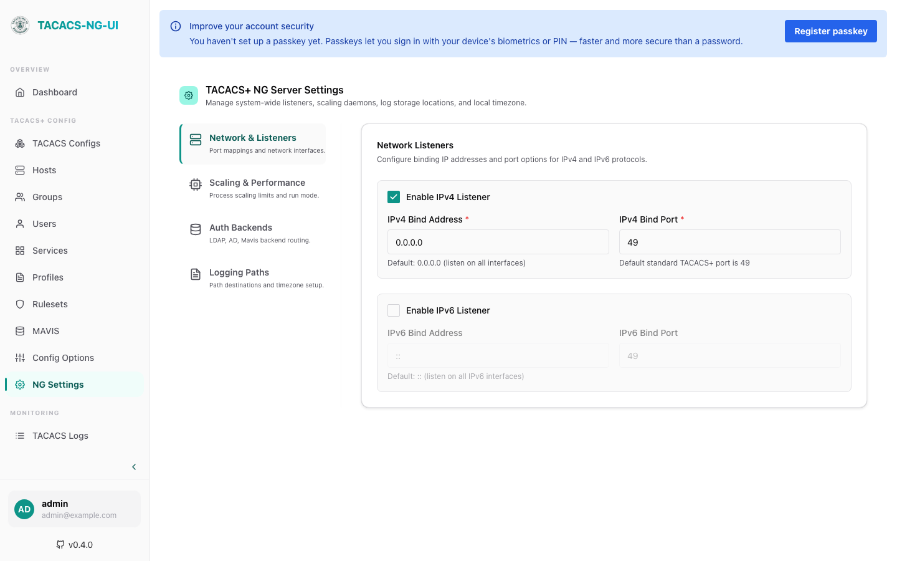

| Field | Description |
|-------|-------------|
| `ipv4_enabled` | Enable IPv4 listener |
| `ipv4_address` | Bind address (use `0.0.0.0` to listen on all interfaces) |
| `ipv4_port` | TACACS+ port (default: `49`) |
| `ipv6_enabled` | Enable IPv6 listener |
| `ipv6_address` | IPv6 bind address |
| `ipv6_port` | IPv6 TACACS+ port |
| `instances_min` | Minimum server process instances |
| `instances_max` | Maximum server process instances |
| `background` | Run server in background (`yes`/`no`) |
| `access_logfile_destination` | Path pattern for access logs (e.g., `/var/log/tacacs/%Y/%m/%d/access.log`) |
| `authentication_logfile_destination` | Path for authentication logs |
| `authorization_logfile_destination` | Path for authorization logs |
| `accounting_logfile_destination` | Path for accounting logs |
| `login_backend` | Backend for login auth (`local`, `mavis`) |
| `user_backend` | Backend for user lookups |
| `pap_backend` | Backend for PAP auth |

Log path patterns support `strftime` format — `%Y/%m/%d` creates daily log rotation.

> **After changing server settings:** regenerate and activate config.

---

## Generating and Applying Config Files

**Path:** Sidebar → TACACS Configs

> ### ⚠️ CRITICAL — MUST DO AFTER EVERY CHANGE
>
> Changes to users, groups, hosts, profiles, rulesets, MAVIS, or server settings have **no effect** on the live TACACS+ server until you regenerate and activate the config.

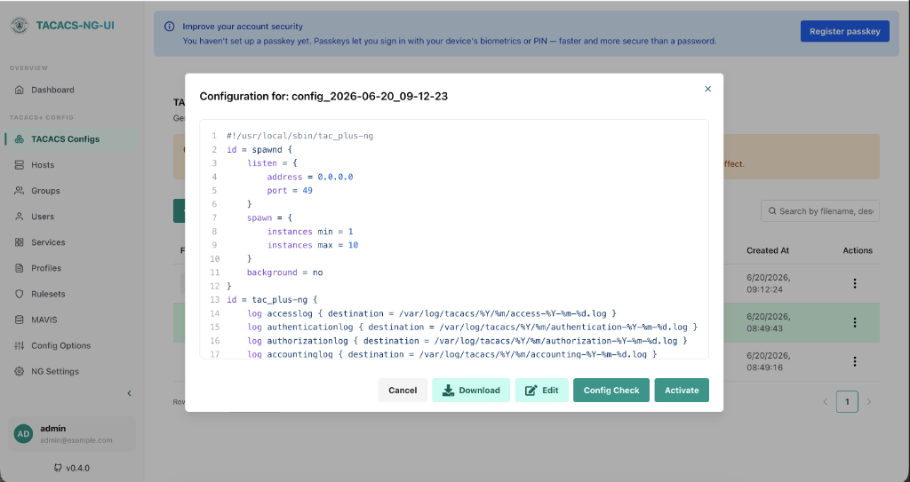

### Workflow: Generate → Preview → Activate

The page follows a three-step workflow. Each config snapshot is versioned and can be inspected before being promoted.

**Step 1 — Generate Config**

Click **Generate Config** to build a complete `tac_plus-ng` config from all current settings. A dialog asks for a filename and optional description; defaults are pre-filled with the current timestamp.

**Step 2 — Preview Config**

Click **Preview Config** to see what the next generated config would look like without saving it. Useful for reviewing changes before committing.

**Step 3 — Activate**

In the config table, open the Actions menu for any snapshot and select **Activate** to mark it as the live config. The active row is highlighted in green with an **Active** badge.

**Active Config button**

Click **Active Config** to view the currently running configuration file in a syntax-highlighted modal.


### Config Table

| Column | Description |
|--------|-------------|
| Filename | Config snapshot name — click to view file contents |
| Status | Active (green) or Inactive (gray) |
| Description | Optional description set at generation time |
| Created At | Date and time the snapshot was generated |
| Actions | Activate / Delete |

### Config Reload

After activating, the `tac_plus-ng` daemon picks up the changes. In Docker deployments, the config file is written to the `/app/tacacs_config/` volume shared with the TACACS+ server container.

### Viewing TACACS Logs

**Path:** Sidebar → TACACS Logs

View TACACS+ log events. Use the **Events** tab for a structured, filterable view (see [TACACS Log Events Viewer](#tacacs-log-events-viewer)).

---

## Dashboard Overview

**Path:** Sidebar → Dashboard

The dashboard provides a real-time summary of your TACACS+ environment across four sections.

### Today's Log Summary

Three stat cards pulled directly from live TACACS+ log files:

| Card | Metrics |
|------|---------|
| **Authentication** | ✓ Successful logins / ✗ Failed logins today |
| **Authorization** | ✓ Permit decisions / ✗ Deny decisions today |
| **Accounting** | ▶ Session starts / ■ Session stops today |

Click any card to jump to the TACACS Log Events viewer for detailed records.

### Config Overview

Five clickable count cards showing current entity totals:

| Card | Navigates to |
|------|-------------|
| Hosts | `/hosts` |
| TACACS Users | `/tacacs_users` |
| TACACS Groups | `/tacacs_groups` |
| Profiles | `/profiles` |
| Rulesets | `/rulesets` |

### Recent User Activity

Compact table of the last 10 audit log entries — shows Time, Dashboard User, Action (color-coded badge), Entity type, and Description. Click **View all →** to open the full Audit Logs page.

### Top 5 & AAA Trend

Four pie charts (Top 5 Source IPs, Top 5 NAS IPs, Top 5 Auth Users, Top 5 Authz Users) and a six-series trend line chart (auth success/fail, authz permit/deny, acct start/stop).

**Filter bar** (above the charts):

| Option | Period |
|--------|--------|
| Last 7 Days | Rolling 7-day window ending today |
| Last 30 Days | Rolling 30-day window ending today |
| Date Range | Custom start and end date inputs |

Default is **Last 7 Days**. All options query the database statistics endpoint; data is updated nightly by the statistics batch job.

---

## TACACS Log Events Viewer

**Path:** Sidebar → TACACS Logs → Events tab

Browse and search structured TACACS+ log events parsed from raw log files.

### Filters

| Filter | Options |
|--------|---------|
| Date | Date picker (defaults to today) |
| Type | All / Authentication / Authorization / Accounting |
| Result | All / Success / Failed / Permit / Deny / Start / Stop |
| Username | Free-text search |

### Event Table Columns

| Column | Description |
|--------|-------------|
| Timestamp | Date and time of the event |
| Type | Authentication / Authorization / Accounting (color badge) |
| Result | Success / Failed / Permit / Deny / Start / Stop (color badge) |
| Username | TACACS username |
| NAS IP | Network device IP address |
| Message | Raw log message |

Results are paginated. Use the date picker and filters to narrow down to specific events.

---

## SIEM Integration

tacacs-ng-ui can send **every TACACS+ log event** and **every audit log entry** to an external SIEM as it happens, over an HTTP webhook (Splunk HEC format) and/or syslog (RFC 5424).

### Configure in the UI

**Admin → SIEM Integration** (superusers only):

1. **Enable SIEM forwarding**.
2. **What to ship**: any of the TACACS+ log types (**Authentication**, **Authorization**, **Accounting**, **Access**) and/or the app **Audit log**.
3. A destination: a **Webhook** URL (with an optional token) and/or a **Syslog** host, port and protocol (UDP or TCP).
4. **Save**, then **Send test event** to check the receiver gets it.

Changes apply on every node within about 10 seconds, with no restart. Settings are edited on the primary; a standby shows them read-only and uses the copy replicated to it.

The **Real-time shipper** card shows the shipper on the node serving the page: running or not, the last event sent, counts per log type, and the last error.

### What is forwarded

**TACACS+ log events.** Each node runs a shipper process that follows its own tac_plus-ng log files under `/var/log/tacacs/` and sends **one event per log line**, normally within a second or two. Primary and standby nodes each ship their own events, so a receiver sees everything the cluster handled. The node name (`NODE_NAME`) is the event's host.

- **No history replay.** When forwarding (or a log type) is switched on, shipping starts from the end of the current file. Nothing written before, or while forwarding was off, is sent.
- **Restarts resume.** The shipper keeps its position in `/var/log/tacacs/.siem/offsets.json`, so a restart (or a shipper that was down over midnight) carries on where it stopped.
- **Delivery is at-least-once** for one destination: the webhook if one is set, otherwise syslog. If it fails, the shipper keeps the batch and retries with backoff (2 s up to 60 s) before reading anything newer, so a receiver outage delays events but does not lose them. A retry can repeat events the receiver had already stored.
- **With both a webhook and syslog**, the webhook decides. A syslog failure then drops those syslog messages (syslog sending pauses for 60 seconds after a failure) while the webhook still gets them.
- **UDP has no delivery confirmation**, so a UDP receiver that is down is not noticed.
- **Large backlogs** (for example after a restart) are worked off over several seconds, up to 10,000 lines per log type per second.

**Audit log entries** (create / update / delete / activate, from the UI or MCP) are sent from the primary when they are recorded, with `sourcetype` `tacacs-ng-ui:audit`.

### Upgrading from env-var configuration

Before this page existed, SIEM forwarding was configured with `SIEM_*` env vars and sent **one daily statistics record per user, device, source IP and result**, repeated on every statistics run. Those daily records are **no longer sent**; per-event shipping replaces them.

On the first start after upgrading, the primary copies the `SIEM_*` env vars into the SIEM Integration settings once:

| Env var | Becomes |
|---|---|
| `SIEM_WEBHOOK_URL`, `SIEM_WEBHOOK_TOKEN` | Webhook URL and token (stored encrypted) |
| `SIEM_SYSLOG_HOST`, `SIEM_SYSLOG_PORT`, `SIEM_SYSLOG_PROTOCOL` | Syslog destination |
| `SIEM_FORWARD_TACACS_EVENTS=true` | Ship Authentication, Authorization and Accounting |
| `SIEM_WEBHOOK_URL` set | Ship Audit log (as before) |

Forwarding is switched on if a webhook URL or syslog host was set. After that the UI owns the settings: editing the env vars has no effect.

### Syslog format

Messages are [RFC 5424](https://datatracker.ietf.org/doc/html/rfc5424), facility `user`. Severity is `warning` for a failed login or a denied command, `info` otherwise:

```
<12>1 2026-11-07T07:00:04.000Z primary tacacs-ng - - - type=authentication username=alice nas_ip=10.0.0.1 port=tty0 client_ip=192.0.2.7 result=failed msg=shell login failed
<14>1 2026-11-07T07:00:05.000Z primary tacacs-ng - - - type=accounting username=alice nas_ip=10.0.0.1 port=tty0 client_ip=192.0.2.7 result=start command=show_version msg=start shell show version <cr>
<14>1 2026-11-07T07:01:00.000Z primary tacacs-ng-ui - - - type=audit action=UPDATE entity_type=Host entity_id=… entity_name=core-sw user_email=admin@example.com ip=198.51.100.4 msg=Updated host core-sw
<14>1 2026-11-07T11:27:30.811Z primary tacacs-ng-ui - - - type=audit action=DELETE entity_type=TacacsUser entity_id=a22b4a0f-… entity_name=abc user_email=admin@example.com ip=198.51.100.4 msg=-
```

| Part | Value |
|---|---|
| Timestamp | When tac_plus-ng wrote the line (UTC); for audit entries, when the change was made |
| Hostname | The node's name (`NODE_NAME`) |
| App name | `tacacs-ng` for TACACS+ events, `tacacs-ng-ui` for audit entries |
| `type` | `authentication`, `authorization`, `accounting`, `access` or `audit` |
| `result` | `success` / `failed`, `permit` / `deny`, `start` / `stop`, or `unknown` |
| `command` | Authorization and accounting only, spaces replaced by `_` |
| `entity_name` | Audit entries only: the name of the object the entry is about (a TACACS+ user's username, a host's name, a group's name, …), spaces replaced by `_`. An id resolves to nothing after a delete, so this is how you tell what was deleted. Left out for objects without a name (the settings pages). Script rows (profile and ruleset scripts) show `key=value`, such as `service=shell` |
| `renamed_from` | Audit entries only, and only when the entry renamed the object: the previous name |
| `msg` | The raw log message, last, with its spaces kept |

Key=value fields never contain spaces. A line the shipper cannot parse is sent as `type=<log type> msg=<the line>`.

Over **TCP** each message ends with a newline (RFC 6587 non-transparent framing), which is what default syslog TCP inputs expect. Over **UDP** each message is one datagram.

### Webhook payload (Splunk HEC format)

Events are POSTed in batches of up to 500, one JSON object per line. Splunk HEC accepts that, and it is also `json_lines` for Logstash:

```json
{"time": 1794034804.0, "host": "primary", "source": "tacacs-ng", "sourcetype": "tacacs-ng:authentication", "event": {"type": "authentication", "node": "primary", "timestamp": "2026-11-07 14:00:04 +0700", "username": "alice", "nas_ip": "10.0.0.1", "port": "tty0", "client_ip": "192.0.2.7", "result": "failed", "command": null, "message": "shell login failed"}}
```

Audit entries use `"source": "tacacs-ng-ui"`, `"sourcetype": "tacacs-ng-ui:audit"` and carry `id`, `action`, `entity_type`, `entity_id`, `entity_name`, `renamed_from`, `user_id`, `user_email`, `ip_address` and `description`. Only the name is sent from an entry's before and after values, never the values themselves. With a token set, each request carries `Authorization: Splunk <token>`. Any response other than 2xx counts as a failure and is retried.

### Per-event forwarding by tac_plus-ng itself (Remote Syslog Destination)

tac_plus-ng can also send its own syslog for every event, independent of the shipper above. You can use either or both.

1. **TACACS NG Settings** → **Remote Syslog Destination**: an IPv4 address with an optional port, e.g. `192.0.2.10:514`. Leave it empty to disable.
2. **Generate** and **Activate** a configuration. The setting is part of the tac_plus-ng config, so it reaches standby nodes with the normal config sync.

The generated config adds these lines next to the local log files, which stay as they are, so statistics, alerts, the TACACS+ Logs page and the SIEM shipper keep working:

```
log remotelog { destination = 192.0.2.10:514 }
access log = remotelog
authentication log = remotelog
authorization log = remotelog
accounting log = remotelog
```

Messages are BSD syslog (RFC 3164), one per event, fields separated by `|`:

```
<70>Nov  7 14:00:04 primary tacplus[184]: AUTHC-FAIL|10.0.0.1|alice|tty0|192.0.2.7|shell login failed
<70>Nov  7 14:00:05 primary tacplus[184]: ACCT-START|10.0.0.1|alice|tty0|192.0.2.7|start|shell|show version <cr>
```

- **Hostname** is the backend container's hostname, which `docker-compose.yml` sets to `NODE_NAME` from `.env`. Use a `NODE_NAME` without spaces, and recreate the backend container after changing it.
- **Timestamp** is the node's local time **without a time zone**, as RFC 3164 defines it. Tell the receiver which zone that is. In Graylog, set **Time Zone** on the Syslog UDP input to the node's `TZ` (e.g. `Asia/Ho_Chi_Minh`); otherwise the time is read as UTC and is off by the zone offset.
- **Limits:** UDP only, IPv4 only, one destination, no webhook. tac_plus-ng does not accept a hostname here. Allow UDP from every node to the destination.

### Supported receivers

| Platform | How |
|----------|-----|
| Splunk | HTTP Event Collector (HEC) webhook, or a syslog input |
| Graylog | **Syslog TCP** or **Syslog UDP** input with default settings. GELF is not supported: the webhook payload is Splunk HEC, not GELF. |
| Elastic / Logstash | Syslog input, or an HTTP input with the `json_lines` codec |
| Any syslog receiver | RFC 5424 over UDP, or TCP with newline framing |

---

## Monitoring & Statistics

### AAA Statistics (Today)

**Path:** Sidebar → AAA Statistics

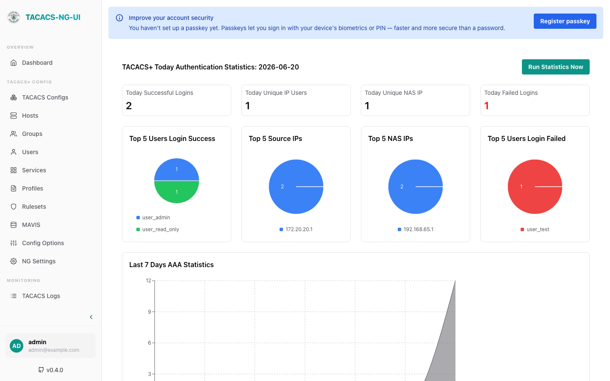

Shows today's totals:
- Authentication success/failure counts
- Authorization permit/deny counts
- Accounting start/stop events
- 7-day trend charts

In a multi-node HA deployment a **Node** dropdown appears at the top right. Select a specific node to view only that node's statistics, or leave it on **All Nodes** to see aggregated totals across all nodes.

### AAA Statistics Range

**Path:** Sidebar → AAA Range Stats

Select a custom date range to view aggregated statistics. In multi-node deployments a **Node** dropdown filters the charts to a single node.

### Node Comparison

**Path:** Sidebar → Node Comparison

Side-by-side comparison of all TACACS-NG nodes over a selected date range. Each node appears as a card showing:
- Authentication success / failure totals
- Authorization permit / deny totals
- Accounting start / stop totals
- Per-node trend chart (AreaChart)
- Top 3 users by success and by failure

The date range picker at the top applies to all node cards simultaneously. Cards load in parallel — each node's data is fetched independently.

> **Multi-node setup required.** This page shows "No node statistics found" on a single-node deployment until statistics have been collected. Run `POST /api/v1/aaa_statistics/run/` or wait for the nightly cron job.

### Excluding Service Accounts from Statistics

**Path:** Sidebar → AAA Statistics → **Manage** (superusers only)

Automation accounts such as an inventory collector (`data_collector`) that logs into every device on a schedule can generate far more AAA events than the people who actually run the network. They take over "top users", inflate the totals and trends, and make every device look busy. To leave them out, add them to the list of accounts excluded from statistics.

- **Username or pattern**: an exact username, or a pattern with `*` as a wildcard (`svc_*`, `*_monitor`). Matching is case-insensitive. A pattern made only of `*` is rejected.
- **Note**: optional, e.g. why the account is excluded.

Once an account is excluded, it is left out of:

- the AAA Statistics page: Today, Historic Range and Node Comparison (counters, top users, per-IP and per-device charts, trends);
- the Dashboard: Today's Log Summary, Top 5 and the AAA trend;
- the per-row statistics endpoints (`/authentication_statistics`, `/authorization_statistics`, `/accounting_statistics`).

The filter is applied when statistics are read, not when logs are collected. Adding an account therefore also removes it from past days, and removing it brings its history back.

While exclusions are active, the AAA Statistics page shows a bar listing them, and the Dashboard shows "N accounts excluded from statistics", so nobody reads filtered numbers as totals. Tick **Include excluded** on the statistics page to see the unfiltered numbers for a while. API clients pass `include_excluded=true`, and filtered responses list the applied patterns in `excluded_users`.

> **Statistics only.** An exclusion never changes what tac_plus-ng does or what gets recorded. The account still authenticates and is still authorized by its rules. Every event is still written to the raw log files and shown in the **TACACS Log Events Viewer**. It still counts for **alert rules** (an excluded account can still trigger a failed-login alert) and for anomaly detection, and it is still forwarded to the SIEM.

Adding and removing exclusions is written to the audit log (`StatsExcludedUser`). It is managed through `GET/POST /api/v1/stats_exclusions/` and `DELETE /api/v1/stats_exclusions/{id}`. Reading the list needs any logged-in user. Changing it needs a superuser on the primary node.

### Authentication Statistics

**Path:** Sidebar → Authentication Statistics


Per-user, per-device breakdown of authentication events (success/failure counts).

### Authorization Statistics

**Path:** Sidebar → Authorization Statistics


Per-user breakdown of authorization decisions (permit/deny counts).

### Accounting Statistics

**Path:** Sidebar → Accounting Statistics


Per-user session accounting (start/stop event counts).

### TACACS Statistics

**Path:** Sidebar → TACACS Statistics

Server-wide performance and request statistics.

---

## Audit Logs

**Path:** Sidebar → Audit Logs

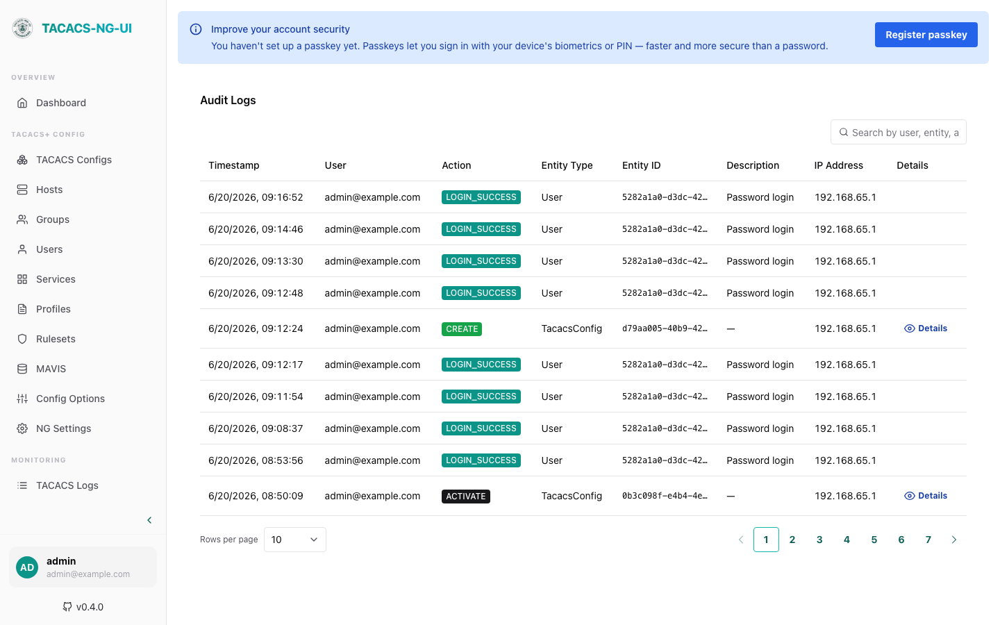

Every configuration change made through the UI is recorded:

| Field | Description |
|-------|-------------|
| `action` | `create`, `update`, `delete` |
| `entity_type` | What was changed (e.g., `TacacsUser`, `Host`) |
| `entity_id` | UUID of the changed record |
| `user_email` | Dashboard user who made the change |
| `ip_address` | IP address of the user's browser |
| `old_values` | Snapshot before the change |
| `new_values` | Snapshot after the change |
| `timestamp` | When the change occurred |

Use audit logs to track who changed what and when — essential for compliance and troubleshooting.

---

## Application User Management

These are users who log into the **dashboard** (not TACACS device users).

**Path:** Sidebar → Admin → Users Management (superuser only)

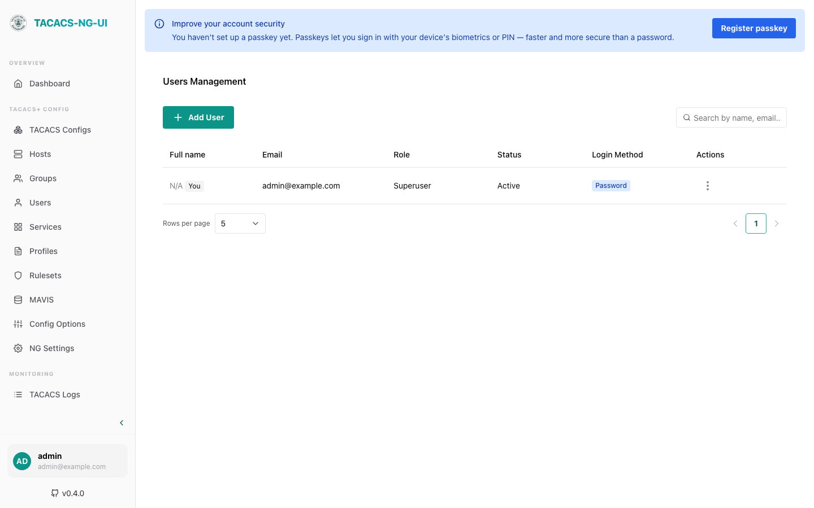

| Field | Description |
|-------|-------------|
| `email` | Login email |
| `full_name` | Display name |
| `is_active` | Activate or deactivate the account |
| `is_superuser` | Grant full admin access |
| `password_login_disabled` | Force OAuth/Passkey login only (disable password) |

### Auth Providers

**Path:** Sidebar → Admin → Auth Providers

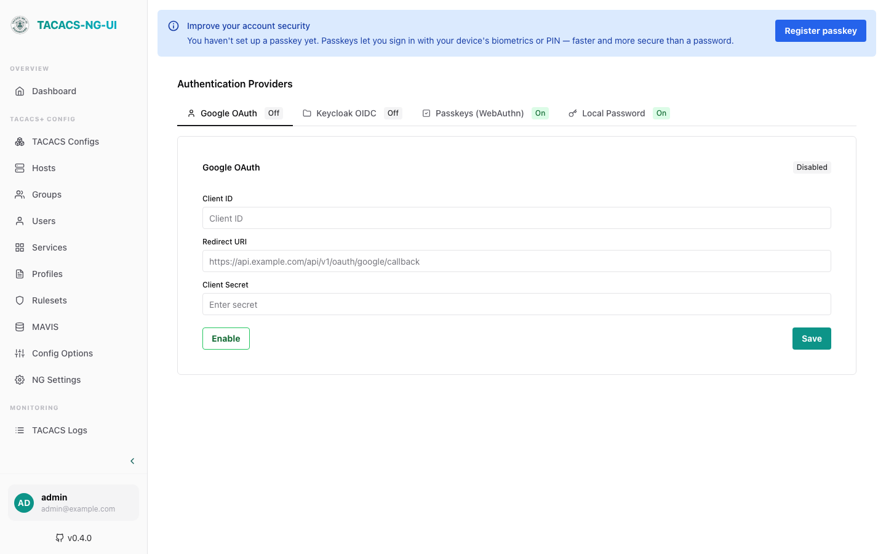

Configure which authentication methods are enabled for the dashboard:

| Provider | Configuration |
|----------|--------------|
| `google` | Requires client ID and client secret (UI or `GOOGLE_CLIENT_ID` / `GOOGLE_CLIENT_SECRET` in `.env`). The redirect URI is prefilled from the site URL |
| `keycloak` | Requires Keycloak server URL, client ID, and client secret |
| `microsoft` | Requires tenant, application (client) ID, and client secret. See [Microsoft Entra ID setup](#microsoft-entra-id-setup) |
| `passkeys` | WebAuthn — no extra config required; users register passkeys from their profile settings |

#### Microsoft Entra ID setup

One provider covers personal Microsoft accounts and Entra ID (work/school) accounts.

1. In the **Entra admin center → App registrations → New registration**, pick the supported account types that match your goal, and add a **Web** redirect URI. Use the exact value prefilled in the form: `https://<your-domain>/api/v1/oauth/microsoft/callback`.
2. Under **Certificates & secrets**, create a client secret and copy its **Value** (not the Secret ID — it is shown only once).
3. In **Admin → Auth Providers → Microsoft Entra ID**, set the **Tenant**, **Application (client) ID** and **Client Secret**, click **Save**, then **Enable**.

| Tenant | Who can sign in |
|--------|-----------------|
| `common` (default) | Work, school and personal accounts |
| `organizations` | Work and school accounts from any Entra tenant |
| `consumers` | Personal Microsoft accounts only |
| a tenant ID or domain | One organization only |

> **Existing accounts.** A person whose email already has a local account is linked to it on first Microsoft sign-in **only** with a single-tenant setup or a personal account. With `common` or `organizations` the sign-in is refused (HTTP 403) instead, because Entra's email claim is not verified and linking on it would let another tenant take over the account. New users are still created normally. To let existing users sign in with Microsoft, restrict the tenant to your own organization.

New users are created without admin rights.

### Password Recovery

Users can request a password reset email from the login page. Requires SMTP configured in `.env` (`SMTP_HOST`, `SMTP_USER`, `SMTP_PASSWORD`, `EMAILS_FROM_EMAIL`).

### User Account Settings

**Path:** Sidebar → Settings

Each user can:
- Update their name and email
- Change their password
- Register or remove passkeys

---

## Advanced: MAVIS Backends

**Path:** Sidebar → Mavises

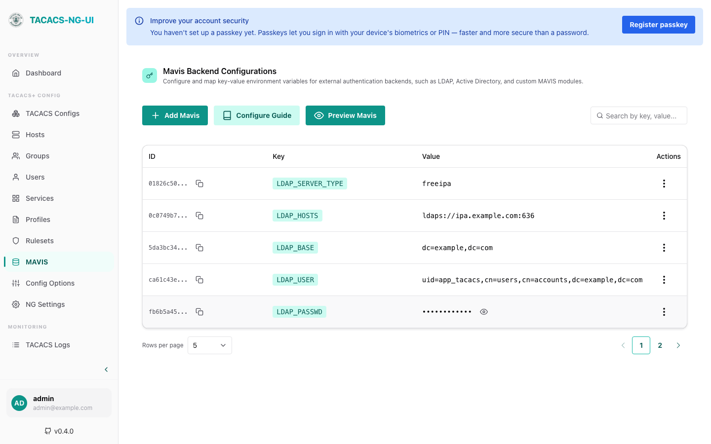

MAVIS (Modular AAA Via Integrated Scripts) allows `tac_plus-ng` to delegate authentication to external systems (LDAP, Active Directory, etc.).

| Field | Description |
|-------|-------------|
| `mavis_key` | MAVIS configuration directive |
| `mavis_value` | Value for the directive |

Use **Preview** to see the MAVIS config block that will be generated.

Typical use case: authenticate TACACS users against Active Directory via LDAP MAVIS module instead of local passwords.

> **After changing MAVIS settings:** regenerate and activate config.

---

## Advanced: Custom Configuration Options

**Path:** Sidebar → Configuration Options

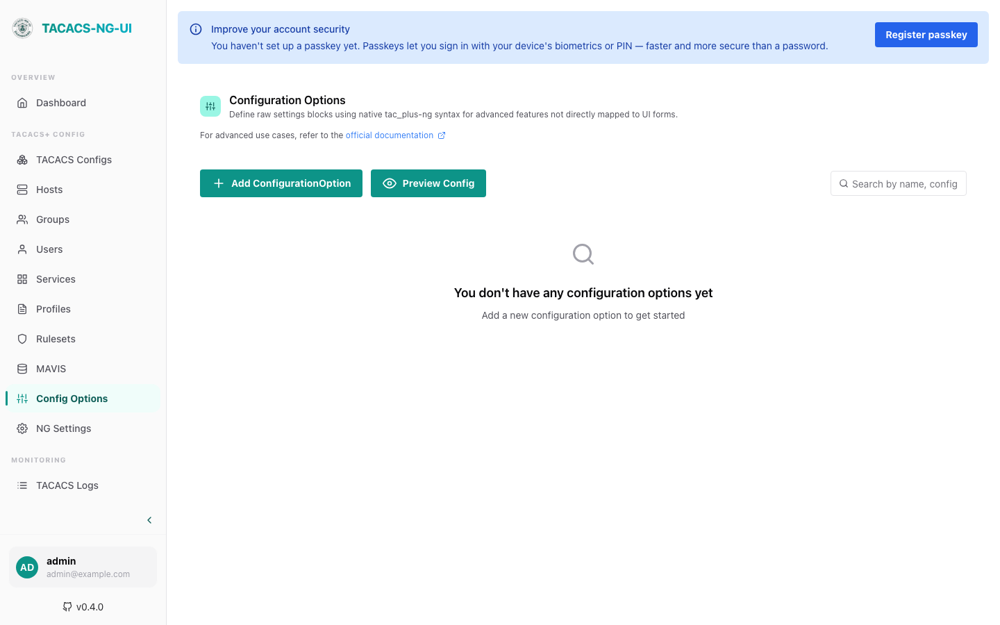

Inject raw `tac_plus-ng` configuration blocks that are not covered by the UI fields.

| Field | Description |
|-------|-------------|
| `name` | Scope the text is injected into: `host`, `group`, `user`, `profile` or `rule` (unique — one entry per scope) |
| `config_option` | Raw configuration text, inserted verbatim into that section |
| `description` | Optional description |

Use this for advanced directives like custom ACLs, time-based access controls, or any `tac_plus-ng` feature not exposed in the UI.

> **After adding custom options:** regenerate and activate config.

### Complex rules

The Rulesets UI intentionally stays with the basic case. Anything more
elaborate — nested `if`, boolean combinations, regex, complex user/device
filters — is written as raw `tac_plus-ng` text in a Configuration Option with
`name = rule`; it is placed inside the generated `ruleset { }` block.

```
rule admin-from-mgmt {
    enabled = yes
    script {
        if (member == admins) {
            if (host == core-switch-01 || host == core-switch-02) {
                set priv-lvl = 15
                permit
            }
        }
        deny
    }
}
```

The groups and hosts a rule refers to (`admins`, `core-switch-01` above) must
already exist, or `tac_plus-ng` rejects the config.

### Moving raw profiles out of the `profile` option

Profiles no longer need the `profile` Configuration Option: use a
[raw script profile](#raw-script-profiles) instead, which Rulesets can select
directly. To move one written here before, often with a script-less
placeholder Profile of the same name:

1. Open the placeholder profile (or create the profile) and switch it to
   **Raw script**.
2. Paste the text between that block's `script {` and its closing `}`.
3. Delete the whole `profile <name> { ... }` block from the `profile`
   Configuration Option.
4. Generate and Activate.

Generate refuses a config where a profile is defined both ways, and names it.

Check the syntax before activating with the Generate / validate step in the UI,
or with the MCP tools `validate_config_text` / `validate_generated_config`.
An LLM client with `mcp:write` can author the option for you; it still cannot
activate it — that stays a human step. See [MCP Server](mcp-server.md).

---

## Troubleshooting

| Symptom | Check |
|---------|-------|
| Device cannot authenticate | Verify `secret_key` matches on both Host and device config; verify config was regenerated and activated |
| Changes not taking effect | **Regenerate and activate config** — this is the most common cause |
| Authentication succeeds but no exec shell | Ensure profile returns `service=exec` and `priv-lvl` attribute |
| User not in group policy | Confirm user's `member` field matches exact group name |
| No logs appearing | Check `accounting_logfile_destination` path and directory permissions |
| 401/403 on dashboard | Token expired — log out and back in |
| Config syntax error | Check TACACS Logs for `tac_plus-ng` error output |

---

## Quick Reference: Typical Workflow

```
1. Server Settings        → set IP, port, log paths
2. TACACS Groups          → create groups (e.g., admins, read-only)
3. TACACS Users           → create users, assign to groups
4. Profiles               → define auth response (priv-lvl, service)
5. Profile Scripts        → add key-value attributes to profile
6. Rulesets               → map users/groups to profiles via conditions
7. Hosts                  → add devices with IP and secret key
8. ⚠️  TACACS Configs     → GENERATE CONFIG → mark ACTIVE  ← REQUIRED AFTER EVERY CHANGE
9. Device Config          → configure device to point at TACACS+ server
10. Monitor               → use Statistics and Logs to verify operation
```

---

## Useful Links

- TACACS+ Server: [tac_plus-ng](https://github.com/MarcJHuber/event-driven-servers)
- API Docs: `http://<your-host>:8000/docs` (also see screenshot below)
- Deployment Guide: [deployment.md](./deployment.md)
- Development Guide: [development.md](./development.md)
- Release Notes: [release-notes.md](./release-notes.md)
- Community: [Telegram](https://t.me/+v1eAXg-BhotlODY1) | [Reddit](https://www.reddit.com/r/tacacs_ng_ui/)

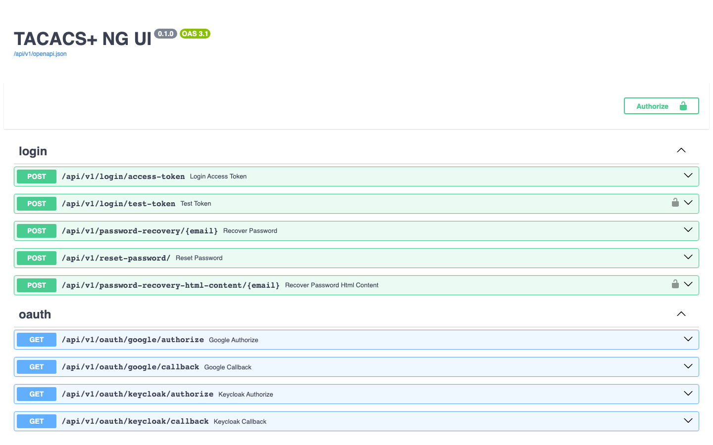
